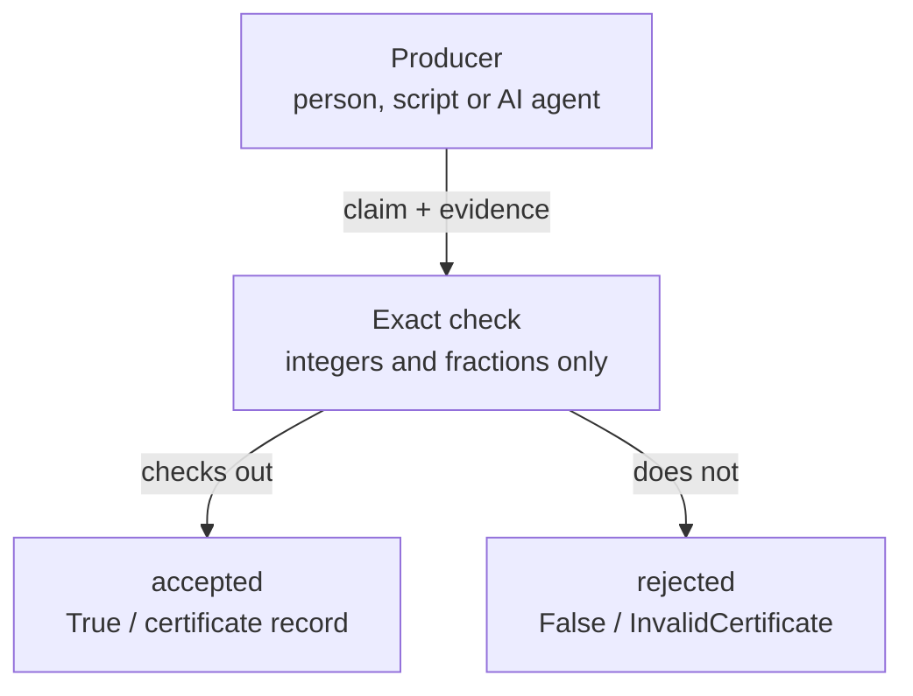

# Foundation Math

Foundation Math checks supplied proofs of specific kinds of mathematical claims,
mostly about linear inequalities: you hand it a claim plus the evidence for it,
and it verifies the claim exactly with whole numbers and fractions, never floating
point, using only the Python standard library.

[](LICENSE)

## Why

Results from scripts, notebooks and AI agents often arrive with a confident
"this is proved" attached. The program that produced a result is a poor judge of
it. Foundation Math is the separate judge: it never writes the proof, it only
checks one. A claim is accepted only when an exact computation or a supplied
certificate checks out. Otherwise it is rejected.

Most of it is a Python library for linear problems: proofs that inequalities
imply other inequalities, that a system has no solution, that a quantity has a
single value, and exact error bounds. Each module works on its own.

### What a Foundation is

A Foundation is a read-only checker for one subject. Another program (the
producer: a person, a script or an AI agent) makes a result; the Foundation judges
it and reports what it found. It changes nothing and controls nothing. Producers never grade their own work.
Foundation Math is the maths Foundation in the Cstack family (code name
Mjölnir). [Cstack](https://github.com/Akilleez-QA/cstack) is a host that keeps a
hash-pinned copy of each Foundation and refuses to run one whose files changed.
You don't need Cstack: use this repository directly as a library. Cstack
currently pins an older subset (v0.14) of it.

## How it works



The producer supplies a claim and a witness, for example the multipliers that
prove an inequality. The module checks the witness with exact arithmetic and
answers yes or no; it never searches for a proof. A failed or missing proof is
not evidence that the claim is false. The set of checks is fixed in code; a new
kind of claim needs a new module or kernel, with tests.

## Example

Check a proof that `x + 2y <= 9` on the box `0 <= x <= 2`, `0 <= y <= 3`, and
watch the same proof fail for the false claim `x + 2y <= 7` (on that box
`x + 2y` reaches 8). Run from the repository root:

```sh
python3 -S -B - <<'EOF'
from fm_certificates import AffineSystem, InvalidCertificate, make_implication

# A label, the number of variables (x, y), then rows (a, b, c) meaning a*x + b*y + c <= 0.
box = AffineSystem("demo", 2, ((1, 0, -2), (-1, 0, 0), (0, 1, -3), (0, -1, 0)))

# The target x + 2y - 9 <= 0 uses the same (a, b, c) form.
# One multiplier per row, in order: 1 times (x <= 2) plus 2 times (y <= 3).
make_implication(box, target=(1, 2, -9), multipliers=(1, 0, 2, 0))
print("x + 2y <= 9: accepted")

try:
    make_implication(box, target=(1, 2, -7), multipliers=(1, 0, 2, 0))
except InvalidCertificate as error:
    print("x + 2y <= 7: rejected:", error)
EOF
```

```text
x + 2y <= 9: accepted
x + 2y <= 7: rejected: Supplied implication witness did not verify
```

`make_implication` returns a frozen certificate record, which carries a SHA-256
digest of the exact system it was checked against, or raises `InvalidCertificate`.
Multipliers must be non-negative, and extra slack in the constant is allowed
(here the witness proves `x + 2y <= 8`, which implies `<= 9`).
`verify_implication` gives the same answer as `True` or `False`.

## Install and run

You need Python 3.10 or newer; CI tests on 3.12 only. Nothing is installed.

```sh
git clone https://github.com/Akilleez-QA/foundation-math
cd foundation-math
python3 -S -B -m unittest discover -s tests -t .
```

The tests end with `OK`; then paste the example above. With no package to install,
run Python from the repository root (or put it on `PYTHONPATH`). `-S` and `-B` are
optional: only the standard library loads, and no `.pyc` files are written.

## What is inside

| Module | What it checks | Contract |
|---|---|---|
| `fm_certificates/` | Supplied proofs that linear inequalities imply another inequality, or have no solution | [Affine certificates](docs/AFFINE-CERTIFICATES.md) |
| `fm_identifiability/` | Supplied witnesses that a linear quantity does or does not have a single value on a solution set | [Query identifiability](docs/QUERY-IDENTIFIABILITY.md) |
| `fm_enclosures/` | Exact interval bounds on the residual of an approximate linear solve | [Numerical enclosures](docs/NUMERICAL-ENCLOSURES.md) |
| `fm_minimax/` | Exact quadratic minimax point, dual and Farkas witnesses, KKT thresholds and JSON CLI | [Quadratic minimax certificates](docs/QUADRATIC-MINIMAX.md) |
| `fm_correlated/` | Exact correlated quadratic upper, lower and offset witnesses, scoped exclusion and non-global probes; CLI and [synthetic example](examples/correlated-quadratic.json) | [Correlated quadratic certificates](docs/CORRELATED-QUADRATIC.md) |
| `fm_intervals/` | Exact pointwise consistency and coverage of supplied interval histories | [Interval histories](docs/INTERVAL-HISTORY.md) |
| `fm_paths/` | Exact continuous path bounds and integral bands under supplied interval and rate premises | [Path bounds](docs/PATH-BOUNDS.md) |
| `fm_optimization/` | Supplied rational upper bounds and attaining points for linear optimization problems | [Linear optimization certificates](docs/DUAL-REPAIR.md) |
| `fm_prefix/` | Exact continuation feasibility and conditional state queries for a supplied fixed input prefix | [Fixed-prefix continuation](docs/FIXED-PREFIX.md) |

**Also included:** a command line for SL2(F5) research claims (`fm_research`), a draft-paper writer (`fm_mapper`) and
a scalar one-step control helper (`fm_control`); see [research claims and write-ups](docs/guides/how-to/research-claims.md).
No network, credentials, external solver or package installation is used.

## Limitations

- A pass is a conditional statement about the inputs you supplied, checked under
  stated assumptions. It does not prove surrounding prose, approve an engineering
  design or make a safety decision.
- There is no long-running JSON-RPC bridge or Cstack adapter in this repository.
  Python 3.10 and 3.11 are untested, and twelve implemented behaviours have no test ([gaps](docs/requirements/requirements.md#9-untested-behaviour-requirement-gaps)).

Status: unreleased source candidate, no release tag (candidate name in `PACKAGE.json`). Full list: [limitations and safety-relevant use](docs/guides/explanation/limitations.md).

## Where to go next

- [Tutorial: your first finite check](docs/guides/tutorials/first-check.md) (uses the research command line)
- [Troubleshoot errors and exit codes](docs/guides/how-to/troubleshooting.md)
- [Python API reference](docs/icd/icd-python-api.md) and [command-line reference](docs/icd/icd-stdio.md)
- [Research claims and write-ups](docs/guides/how-to/research-claims.md) and [design](docs/architecture/architecture.md)
- [Documentation index](docs/README.md)

## Related projects

| Repository | Role |
|---|---|
| [Cstack](https://github.com/Akilleez-QA/cstack) | Host; runs Foundations from byte-pinned copies |
| [EndoForge](https://github.com/Akilleez-QA/endoforge) | Research engine that turns short needs into checked WebAssembly kernels |
| [POODO](https://github.com/Akilleez-QA/poodo) | Reasoning skill that shows evidence before it acts |
| [Foundation Engine](https://github.com/Akilleez-QA/foundation-engine) | Browser games framework, with read-only validators |
| Foundation Math (this repository) | Exact checks of mathematical claims and certificates |
| [Foundation Film](https://github.com/Akilleez-QA/foundation-film) | Film-production acceptance checks |
| [Foundation Refrigeration](https://github.com/Akilleez-QA/foundation-refrigeration) | Refrigeration data and checks |
| [Foundation Robotics](https://github.com/Akilleez-QA/foundation-robotics) | Physics checks for motion |
| [Foundation Template](https://github.com/Akilleez-QA/foundation-template) | Minimal Foundation to copy for a new subject |

## Contributing

See [Contributing](CONTRIBUTING.md) (tests, trace check, manifest refresh), [Support](SUPPORT.md),
the [Code of conduct](CODE_OF_CONDUCT.md) and [Security](SECURITY.md).

## Engineering records

The project keeps a documentation set organised after NASA software documentation
guidance. Classification: self-assessed Class E analog, not safety-critical; this
is not a NASA compliance determination
([software management plan](docs/plan/software-management-plan.md#1-software-classification-self-assessed)).

- [Software management plan](docs/plan/software-management-plan.md) and [compliance matrix](docs/plan/compliance-matrix.md)
- [Requirements](docs/requirements/requirements.md) and [verification matrix](docs/verification/verification-matrix.md)
- [Data dictionary](docs/data/data-dictionary.md), [test plan](docs/verification/test-plan.md), [test reports](docs/verification/reports/README.md) and [version descriptions](docs/releases/README.md)
- [Configuration management](docs/configuration/configuration-management.md), [assurance record](docs/assurance/assurance-record.md) and [release checklist](docs/RELEASE-CHECKLIST.md)
- [All control documents with IDs](docs/README.md#engineering-records)

## License

Copyright (c) 2026 Refrigeration AI, Inc. The files listed in `SOURCE-MANIFEST.json`,
including the selected v0.14 source subset, are licensed under GNU GPL **version 3
only** (SPDX: `GPL-3.0-only`), not "or later", and come without warranty. See
[LICENSE](LICENSE), [NOTICE.md](NOTICE.md) for the exact scope and
[PROVENANCE.md](PROVENANCE.md).

This project is available under the GNU General Public License v3.0 only (GPL-3.0-only). If you want to use it to create a product or service under different terms, commercial licenses are available from Refrigeration.AI. Contact craig@nh3.biz.
