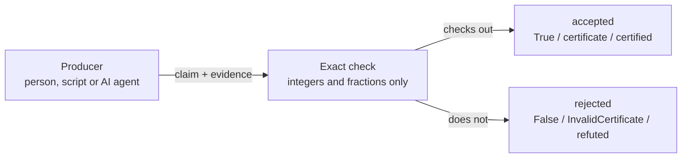

# Foundation Math

Foundation Math checks supplied proofs of specific kinds of mathematical claims,
mostly about linear inequalities: you hand it a claim plus the evidence for it,
and it verifies the claim exactly with whole numbers and fractions, never floating
point, using only the Python standard library.

[](LICENSE)

## Why

Results from scripts, notebooks and AI agents often arrive with a confident
"this is proved" attached. The program that produced a result is a poor judge of
it. Foundation Math is the separate judge: it never writes the proof, it only
checks one. A claim is accepted only when an exact computation or a supplied
certificate checks out. Otherwise it is rejected.

Most of it is a Python library for linear problems: proofs that inequalities
imply other inequalities, that a system has no solution, that a quantity has a
single value, and exact error bounds. A smaller command-line part checks claims
about one finite group, SL2(F5), from the project's original research use. The
modules were added one at a time as exact checks were needed, and each works on
its own.

### What a Foundation is

A Foundation is a read-only checker for one subject. Another program (we call it
the producer: a person, a script or an AI agent) makes a result; the Foundation judges it and reports what it found. It
changes nothing and controls nothing. Producers never grade their own work.
Foundation Math is the maths Foundation in the Cstack family (code name
Mjölnir). [Cstack](https://github.com/Akilleez-QA/cstack) is a host that keeps a
hash-pinned copy of each Foundation and refuses to run one whose files changed.
You don't need Cstack: use this repository directly as a library. Cstack
currently pins an older subset (v0.14) of it.

## How it works



The producer supplies a claim and a witness, for example the multipliers that
prove an inequality. The module checks the witness with exact arithmetic and
answers yes or no; it never searches for a proof. A failed or missing proof is
not evidence that the claim is false. The set of checks is fixed in code; a new
kind of claim needs a new module or kernel, with tests.

## Example

Check a proof that `x + 2y <= 9` on the box `0 <= x <= 2`, `0 <= y <= 3`, and
watch the same proof fail for the false claim `x + 2y <= 7` (on that box
`x + 2y` reaches 8). Run from the
repository root:

```sh
python3 -S -B - <<'EOF'
from fm_certificates import AffineSystem, InvalidCertificate, make_implication

# A label, the number of variables (x, y), then rows (a, b, c) meaning a*x + b*y + c <= 0.
box = AffineSystem("demo", 2, ((1, 0, -2), (-1, 0, 0), (0, 1, -3), (0, -1, 0)))

# The target x + 2y - 9 <= 0 uses the same (a, b, c) form.
# One multiplier per row, in order: 1 times (x <= 2) plus 2 times (y <= 3).
make_implication(box, target=(1, 2, -9), multipliers=(1, 0, 2, 0))
print("x + 2y <= 9: accepted")

try:
    make_implication(box, target=(1, 2, -7), multipliers=(1, 0, 2, 0))
except InvalidCertificate as error:
    print("x + 2y <= 7: rejected:", error)
EOF
```

```text
x + 2y <= 9: accepted
x + 2y <= 7: rejected: Supplied implication witness did not verify
```

`make_implication` returns a frozen certificate record, which carries a SHA-256
digest of the exact system it was checked against, or raises `InvalidCertificate`.
`verify_implication` gives the same answer as `True` or `False`.

## Install and run

You need Python 3.10 or newer; CI tests on 3.12 only. Nothing is installed.

```sh
git clone https://github.com/Akilleez-QA/foundation-math
cd foundation-math
python3 -S -B -m unittest discover -s tests -t .
```

The test suite ends with `OK`. Then paste the example above. There is no package
to install, so run Python from the repository root (or put it on `PYTHONPATH`). The `-S` and `-B`
flags are optional; they prove that only the standard library loads and keep
`.pyc` files out of the tree. Next, follow the
[first-check tutorial](docs/guides/tutorials/first-check.md).

## What is inside

| Module | What it checks | Contract |
|---|---|---|
| `fm_certificates/` | Supplied proofs that linear inequalities imply another inequality, or have no solution | [Affine certificates](docs/AFFINE-CERTIFICATES.md) |
| `fm_identifiability/` | Supplied witnesses that a linear quantity does or does not have a single value on a solution set | [Query identifiability](docs/QUERY-IDENTIFIABILITY.md) |
| `fm_enclosures/` | Exact interval bounds on the residual of an approximate linear solve | [Numerical enclosures](docs/NUMERICAL-ENCLOSURES.md) |
| `fm_control/` | One-step safe-action intervals for a scalar linear model | [Scalar control](docs/SCALAR-CONTROL.md) |
| `fm_research/` | Command line: claims files checked by exact kernels for matrix rank over Q, Q(√5) and prime fields, characters of SL2(F5), and cohomology dimensions of supplied split bundles | [Source binding](docs/SOURCE-BINDING.md) |
| `fm_mapper/` | Command line: takes your own verdict on each claim (`supports`, `refutes` or `inconclusive`) and writes a draft paper whose wording matches that support. It is the write-up step after checking: it reports, it does not judge | [Evidence mapper](docs/EVIDENCE-PAPER.md) |
| `vendor/foundation-math-v014/` | The SL2(F5) character and split-bundle code that `fm_research` imports, kept byte-for-byte from release v0.14 | [Provenance](PROVENANCE.md) |

`tests/` holds synthetic standard-library tests; `tools/` holds the source
packager, manifest refresh and documentation trace check. No network,
credentials, external solver or package installation is used.

## The research command line

`fm_research` reads a problem file of claims. Each computed claim names a kernel,
its arguments and the answer the producer expects. This one, from
[the shipped example](examples/research-regression.problem.json), says the matrix
`[[√5, 0], [0, 3]]` has rank 2 (a plain number is rational; a pair `[a, b]` means
`a + b√5`):

```json
{
  "id": "rank-q5",
  "statement": "The supplied diagonal quadratic-field matrix has rank two.",
  "kind": "computed",
  "depends_on": [],
  "check": {"kernel": "rank", "args": {"field": "Q(sqrt5)", "rows": [[[0, 1], 0], [0, 3]]}, "expect": 2}
}
```

```sh
python3 -S -B -m fm_research check examples/research-regression.problem.json --claim rank-q5
```

```text
{"claim_id": "rank-q5", "status": "certified", "evidence": {"kernel": "rank",
 "expected": 2, "observed": {"rank": 2, "certificate": {"field": "Q(sqrt5)",
 "pivot_rows": [0, 1], "pivot_cols": [0, 1], ...}}, "verdict": "PASS",
 "args_sha256": "2ec6140c...", "kernel_source_sha256": "a9652c11...", ...}}
```

(Output trimmed and wrapped.) The command runs the kernel, records the
arguments hash, the observed answer and a hash of the kernel source, then grades
the claim. `verdict` is the raw comparison with `expect`; `status` is the claim's
standing. Change `"expect": 2` to `1` and it comes back `refuted`.

| `status` | Meaning |
|---|---|
| `certified` | The check passed and every claim it depends on is `certified` or `cited` |
| `refuted` | The check failed |
| `blocked` | The check passed, but a claim it depends on is not certified |
| `unchecked` | The recorded evidence did not match the claim or the current source files |
| `cited`, `argued` | Not computed: a cited source or an argument, passed through as labelled and never upgraded |

The exit code is 0 only when every computed claim you asked about is `certified`,
1 otherwise (including when you asked only about `cited` or `argued` claims), and
2 when the input is malformed. Run the whole example file to see three
`certified` claims and one `argued`.


## Limitations

- A pass is a conditional statement about the inputs you supplied. `certified`
  means one finite check passed under its stated assumptions. It does not prove
  surrounding prose, approve an engineering design or make a safety decision.
- `fm_mapper` reports support under the judgments you supplied. Every report it
  writes is marked `draft_not_scientifically_accepted`.
- `fm_control` is arithmetic for one step of a scalar model. It commands nothing,
  converts no units and is not a controller or simulator.
- There is no stdio bridge or Cstack adapter in this repository. Python 3.10 and
  3.11 are untested, and twelve implemented behaviours have no test ([gaps](docs/requirements/requirements.md#9-untested-behaviour-requirement-gaps)).

Status: unreleased source candidate, no release tag (candidate name in `PACKAGE.json`). Full list: [limitations and safety-relevant use](docs/guides/explanation/limitations.md).

## Where to go next

- [Tutorial: your first finite check](docs/guides/tutorials/first-check.md)
- [Troubleshoot errors and exit codes](docs/guides/how-to/troubleshooting.md)
- [Python API reference](docs/icd/icd-python-api.md) and [command-line reference](docs/icd/icd-stdio.md)
- [Design](docs/architecture/architecture.md)
- [Documentation index](docs/README.md)

Before changing code, run both test modes (`-O` repeats the suite with
assertions stripped). Both include the documentation trace check
(`tests/test_trace.py`):

```sh
python3 -S -B -m unittest discover -s tests -t .
python3 -S -B -O -m unittest discover -s tests -t .
```

After changing a shipped file, run `python3 -S -B -m tools.refresh_manifest`.
To build a source ZIP, follow the [source packaging guide](docs/guides/how-to/source-package.md).
Run the packager on a clean export (`git archive`), not on the clone itself,
because `.git` is not on its file list.

## Related projects

| Repository | Role |
|---|---|
| [Cstack](https://github.com/Akilleez-QA/cstack) | Host; runs Foundations from byte-pinned copies |
| [EndoForge](https://github.com/Akilleez-QA/endoforge) | Workshop for running coding agents with checks and receipts |
| [POODO](https://github.com/Akilleez-QA/poodo) | Reasoning skill that shows evidence before it acts |
| [Foundation Engine](https://github.com/Akilleez-QA/foundation-engine) | Browser games framework, with read-only validators |
| Foundation Math (this repository) | Exact checks of mathematical claims and certificates |
| [Foundation Film](https://github.com/Akilleez-QA/foundation-film) | Film-production acceptance checks |
| [Foundation Refrigeration](https://github.com/Akilleez-QA/foundation-refrigeration) | Refrigeration data and checks |
| [Foundation Robotics](https://github.com/Akilleez-QA/foundation-robotics) | Motion checks for robots |
| [Foundation Template](https://github.com/Akilleez-QA/foundation-template) | Minimal Foundation to copy for a new subject |

## Contributing

See [Contributing](CONTRIBUTING.md), [Support](SUPPORT.md) and the
[Code of conduct](CODE_OF_CONDUCT.md). Report security issues through
[Security](SECURITY.md).

## Engineering records

The project keeps a documentation set organised after NASA software documentation
guidance. Classification: self-assessed Class E analog, not safety-critical; this
is not a NASA compliance determination
([software management plan](docs/plan/software-management-plan.md#1-software-classification-self-assessed)).

- [Software management plan](docs/plan/software-management-plan.md) and [compliance matrix](docs/plan/compliance-matrix.md)
- [Requirements](docs/requirements/requirements.md) and [verification matrix](docs/verification/verification-matrix.md)
- [Data dictionary](docs/data/data-dictionary.md), [test plan](docs/verification/test-plan.md), [test reports](docs/verification/reports/README.md) and [version descriptions](docs/releases/README.md)
- [Configuration management](docs/configuration/configuration-management.md), [assurance record](docs/assurance/assurance-record.md) and [release checklist](docs/RELEASE-CHECKLIST.md)
- [All control documents with IDs](docs/README.md#engineering-records)

## License

Copyright (c) 2026 Refrigeration AI, Inc. The files listed in `SOURCE-MANIFEST.json`,
including the selected v0.14 source subset, are licensed under GNU GPL **version 3
only** (SPDX: `GPL-3.0-only`), not "or later", and come without warranty. See
[LICENSE](LICENSE), [NOTICE.md](NOTICE.md) for the exact scope and
[PROVENANCE.md](PROVENANCE.md).

This project is available under the GNU General Public License v3.0 only (GPL-3.0-only). If you want to use it to create a product or service under different terms, commercial licenses are available from Refrigeration.AI. Contact craig@nh3.biz.
