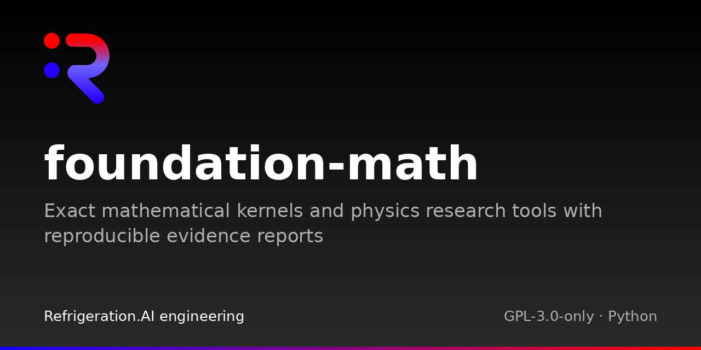
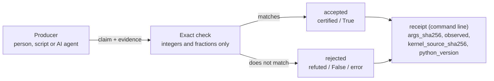

# Foundation Math

Foundation Math checks specific kinds of mathematical claims exactly: you hand it
a claim plus the evidence for it, and it recomputes or verifies the claim with
whole numbers and fractions, never floating point, using only the Python standard
library. It has two parts: general checkers for proofs about linear inequalities
and linear systems, and a command-line checker for the claims of one algebra
research project.

[](LICENSE)

## Why

Results from scripts, notebooks and AI agents often arrive with a confident
"this is proved" attached. The program that produced a result is a poor judge of
it. Foundation Math is the separate judge: it never writes the proof, it only
checks one. A claim is accepted only when an exact computation or a supplied
certificate checks out. Otherwise it is rejected, and you get a receipt saying
what was checked.

### What a Foundation is

Foundation Math is one of the Foundations in the Cstack family (code name
Mjölnir). A Foundation is a read-only checker for one subject. Another program,
the producer, makes a result; the Foundation judges it and reports what it found.
It changes nothing and controls nothing. Producers never grade their own work.
[Cstack](https://github.com/Akilleez-QA/cstack) runs each Foundation from a
copy whose file hashes it has pinned, so the judge itself can't be swapped
quietly.

## How it works



There are two ways in. The command line reads a problem file: a list of claims,
each naming an exact kernel (a small function such as "rank of this matrix") and
the answer the producer expects. Foundation Math runs the kernel and writes an
evidence record (arguments hash, observed answer, hash of the kernel source).
A separate gate then re-checks that record against the claim and the current
source files, compares the answer with the expected one, and prints one JSON line
per claim. A claim that depends on another is certified only if everything below
it is too. `--evidence-out FILE` saves the records. The Python
modules check certificates: the producer supplies a witness (for example, the
multipliers that prove an inequality) and the module checks it exactly. They
return plain values or frozen records; the `fm_certificates` and
`fm_identifiability` records carry a SHA-256 digest of the exact statement checked. Neither
path searches for a proof; a missing or failed proof is not evidence that a claim
is false.

All the modules share that one rule: the producer supplies the claim and the
evidence, and the module only checks. The set of checks is fixed in code. A new
kind of claim needs a new kernel (an entry in `KERNELS` in
`fm_research/problem.py`) or a new module, with tests.

## Example

Check a proof that `x + 2y <= 9` on the box `0 <= x <= 2`, `0 <= y <= 3`, and
watch the same proof fail for the false claim `x + 2y <= 7`. Run from the
repository root:

```sh
python3 -S -B - <<'EOF'
from fm_certificates import AffineSystem, InvalidCertificate, make_implication

# Each row (a, b, c) means a*x + b*y + c <= 0.
box = AffineSystem("demo", 2, ((1, 0, -2), (-1, 0, 0), (0, 1, -3), (0, -1, 0)))

# The witness: 1 times (x <= 2) plus 2 times (y <= 3).
make_implication(box, target=(1, 2, -9), multipliers=(1, 0, 2, 0))
print("x + 2y <= 9: accepted")

try:
    make_implication(box, target=(1, 2, -7), multipliers=(1, 0, 2, 0))
except InvalidCertificate as error:
    print("x + 2y <= 7: rejected:", error)
EOF
```

```text
x + 2y <= 9: accepted
x + 2y <= 7: rejected: Supplied implication witness did not verify
```

`make_implication` returns a frozen certificate record when the witness checks
out and raises `InvalidCertificate` when it does not. `verify_implication` gives
the same answer as `True` or `False`.

The command line works on a problem file. Each claim names a kernel, its
arguments and the answer the producer expects. This claim from
[the shipped example](examples/research-regression.problem.json) says the matrix
`[[√5, 0], [0, 3]]` has rank 2. A plain number is a rational entry; a pair
`[a, b]` means `a + b√5`:

```json
{
  "id": "rank-q5",
  "statement": "The supplied diagonal quadratic-field matrix has rank two.",
  "kind": "computed",
  "depends_on": [],
  "check": {"kernel": "rank", "args": {"field": "Q(sqrt5)", "rows": [[[0, 1], 0], [0, 3]]}, "expect": 2}
}
```

Foundation Math recomputes the rank and certifies the claim (output trimmed and
wrapped):

```sh
python3 -S -B -m fm_research check examples/research-regression.problem.json --claim rank-q5
```

```text
{"claim_id": "rank-q5", "status": "certified", "evidence": {"kernel": "rank",
 "expected": 2, "observed": {"rank": 2, "certificate": {"field": "Q(sqrt5)",
 "pivot_rows": [0, 1], "pivot_cols": [0, 1], ...}}, "verdict": "PASS",
 "args_sha256": "2ec6140c...", "kernel_source_sha256": "a9652c11...", ...}}
```

Change `"expect": 2` to `1` and the claim comes back `refuted`. Each output line
has two results. `verdict` is the raw comparison: `PASS` if the kernel's answer
equals `expect`, `FAIL` if not. `status` is the claim's standing:

| `status` | Meaning |
|---|---|
| `certified` | The check passed and every claim it depends on is `certified` or `cited` |
| `refuted` | The check failed |
| `blocked` | The check passed, but a claim it depends on is not certified |
| `unchecked` | The evidence record was missing, or did not match the claim's kernel, arguments or expected value, or the current source files |
| `cited`, `argued` | Not computed. A cited source or an argument is passed through as labelled, never upgraded |

The exit code is 0 only when every computed claim you asked about is `certified`,
1 otherwise (including when you ask only about `cited` or `argued` claims), and 2
when the input is malformed.

## Install and run

You need Python 3.10 or newer; CI tests on 3.12 only. Nothing is installed. The
flags keep runs clean: `-S` skips site packages so only the standard library
loads, and `-B` writes no `.pyc` files.

```sh
git clone https://github.com/Akilleez-QA/foundation-math
cd foundation-math
python3 -S -B -m fm_research check examples/research-regression.problem.json
python3 -S -B -m unittest discover -s tests -t .
```

The first command prints four claims: three `certified` and one `argued` (an
argument nobody checked, which stays labelled as such). The test suite ends with
`OK`. Next, follow the [first-check tutorial](docs/guides/tutorials/first-check.md).

## What is inside

**General checkers** (Python API):

| Module | What it checks | Contract |
|---|---|---|
| `fm_certificates/` | Supplied proofs that linear inequalities imply another inequality, or have no solution | [Affine certificates](docs/AFFINE-CERTIFICATES.md) |
| `fm_identifiability/` | Supplied witnesses that a linear query does or does not have a single value on a solution set | [Query identifiability](docs/QUERY-IDENTIFIABILITY.md) |
| `fm_enclosures/` | Exact interval bounds on the residual of an approximate linear solve | [Numerical enclosures](docs/NUMERICAL-ENCLOSURES.md) |
| `fm_control/` | One-step safe-action intervals for a scalar linear model | [Scalar control](docs/SCALAR-CONTROL.md) |

**Research claims and reports** (command line):

| Module | What it checks | Contract |
|---|---|---|
| `fm_research/` | Problem files of claims, using exact kernels: matrix rank over Q, Q(√5) and prime fields, characters of the finite group SL2(F5), and cohomology dimensions of supplied split bundles on a projective line | [Source binding](docs/SOURCE-BINDING.md) |
| `vendor/foundation-math-v014/` | Selected historical character and split-bundle sources used by `fm_research` | [Provenance](PROVENANCE.md) |
| `fm_mapper/` | Turns evidence judgments you supply into a draft report with qualified wording | [Evidence mapper](docs/EVIDENCE-PAPER.md) |

**Supporting:** `tests/` holds synthetic standard-library tests ([test plan](docs/verification/test-plan.md)); `tools/` holds the source packager, manifest refresh and documentation trace check.

The only command-line entry points are `fm_research` and `fm_mapper`; the other
modules are Python APIs. No network, credentials, external solver or package
installation is used.

## Limitations

- A pass is a conditional statement about the inputs you supplied. `certified`
  means one finite check passed under its stated assumptions. It does not prove
  surrounding prose, approve an engineering design or make a safety decision.
- `fm_mapper` reports support under the judgments you supplied. Every report it
  writes is marked `draft_not_scientifically_accepted`.
- `fm_control` is arithmetic for one step of a scalar model. It commands nothing,
  converts no units and is not a controller or simulator.
- Use this repository; it is the current source. It has no stdio bridge or Cstack
  adapter of its own. Cstack still runs a pinned older subset (v0.14) through its
  own adapter. Python 3.10 and 3.11 are untested, and twelve implemented
  behaviours have no test ([gaps](docs/requirements/requirements.md#9-untested-behaviour-requirement-gaps)).

Status: source candidate `numerical-enclosures-v1-20261105` (from `PACKAGE.json`),
no release tag. Full list: [limitations and safety-relevant use](docs/guides/explanation/limitations.md).

## Where to go next

- [Tutorial: your first finite check](docs/guides/tutorials/first-check.md)
- [Troubleshoot errors and exit codes](docs/guides/how-to/troubleshooting.md)
- [Python API reference](docs/icd/icd-python-api.md) and [command-line reference](docs/icd/icd-stdio.md)
- [Design](docs/architecture/architecture.md)
- [Documentation index](docs/README.md)

Before changing code, run both test modes (`-O` repeats the suite with
assertions stripped). Both include the documentation trace check
(`tests/test_trace.py`):

```sh
python3 -S -B -m unittest discover -s tests -t .
python3 -S -B -O -m unittest discover -s tests -t .
```

After changing a shipped file, run `python3 -S -B -m tools.refresh_manifest`.
To build a source ZIP, follow the [source packaging guide](docs/guides/how-to/source-package.md).
Run the packager on a clean export (`git archive`), not on the clone itself,
because `.git` is not on its file list.

## Related projects

| Repository | Role |
|---|---|
| [Cstack](https://github.com/Akilleez-QA/cstack) | Host; runs Foundations from byte-pinned copies |
| [EndoForge](https://github.com/Akilleez-QA/endoforge) | Workshop for running coding agents with checks and receipts |
| [POODO](https://github.com/Akilleez-QA/poodo) | Reasoning skill that shows evidence before it acts |
| [Foundation Engine](https://github.com/Akilleez-QA/foundation-engine) | Browser games framework, with read-only validators |
| Foundation Math (this repository) | Exact checks of mathematical claims and certificates |
| [Foundation Film](https://github.com/Akilleez-QA/foundation-film) | Film-production acceptance checks |
| [Foundation Refrigeration](https://github.com/Akilleez-QA/foundation-refrigeration) | Refrigeration data and checks |
| [Foundation Robotics](https://github.com/Akilleez-QA/foundation-robotics) | Motion checks for robots |
| [Foundation Template](https://github.com/Akilleez-QA/foundation-template) | Minimal Foundation to copy for a new subject |

## Contributing

See [Contributing](CONTRIBUTING.md), [Support](SUPPORT.md) and the
[Code of conduct](CODE_OF_CONDUCT.md). Report security issues through
[Security](SECURITY.md).

## Engineering records

The project keeps a documentation set organised after NASA software documentation
guidance. Classification: self-assessed Class E analog, not safety-critical; this
is not a NASA compliance determination
([software management plan](docs/plan/software-management-plan.md#1-software-classification-self-assessed)).

- [Software management plan](docs/plan/software-management-plan.md) and [compliance matrix](docs/plan/compliance-matrix.md)
- [Requirements](docs/requirements/requirements.md) and [verification matrix](docs/verification/verification-matrix.md)
- [Data dictionary](docs/data/data-dictionary.md), [test plan](docs/verification/test-plan.md), [test reports](docs/verification/reports/README.md) and [version descriptions](docs/releases/README.md)
- [Configuration management](docs/configuration/configuration-management.md), [assurance record](docs/assurance/assurance-record.md) and [release checklist](docs/RELEASE-CHECKLIST.md)
- [All control documents with IDs](docs/README.md#engineering-records)

## License

Copyright (c) 2026 Refrigeration AI, Inc. The files listed in `SOURCE-MANIFEST.json`,
including the selected v0.14 source subset, are licensed under GNU GPL **version 3
only** (SPDX: `GPL-3.0-only`), not "or later", and come without warranty. See
[LICENSE](LICENSE), [NOTICE.md](NOTICE.md) for the exact scope and
[PROVENANCE.md](PROVENANCE.md).

This project is available under the GNU General Public License v3.0 only (GPL-3.0-only). If you want to use it to create a product or service under different terms, commercial licenses are available from Refrigeration.AI. Contact craig@nh3.biz.
