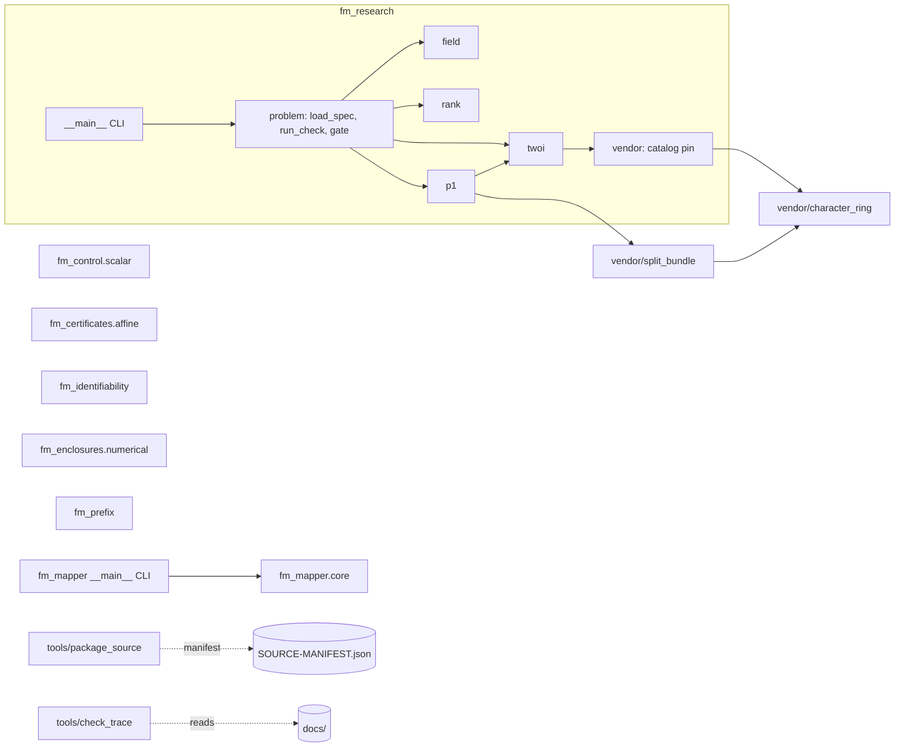
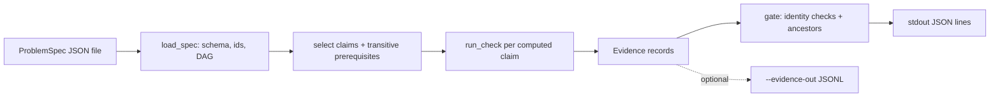
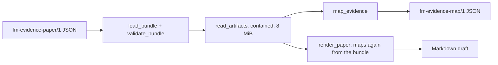

# Foundation Math software design description

| Field | Value |
|---|---|
| Document ID | FMATH-SDD |
| Version | 2.0 |
| Status | Baselined |
| Owner | Akilleez-QA maintainer |
| Date | 2026-11-08 |
| Baseline commit | 53a58dde072b1d3f92836a1365f88f364b880a33 |
| Applies to | foundation-math main at baseline commit, plus the documentation tooling added in PR #30 |
| Classification | Self-assessed Class E analog; not safety-critical (see [SMP §1](../plan/software-management-plan.md#1-software-classification-self-assessed)) |

> Organized after [NPR 7150.2D](https://nodis3.gsfc.nasa.gov/displayAll.cfm?Internal_ID=N_PR_7150_002D_&page_name=all), [NASA-STD-8739.8B](https://standards.nasa.gov/standard/nasa/nasa-std-87398) and the [NASA Software Engineering Handbook](https://swehb.nasa.gov/display/SWEHBVD/7.18+-+Documentation+Guidance) documentation guidance. This is not a NASA compliance determination or certification. The software classification is a self-assessed analog (Class E, not safety-critical); no NASA authority, independent verification and validation, or hazard analysis is asserted. The document describes the implementation inspected at the baseline commit.

## 1. Purpose and design boundary

This document explains how Foundation Math meets its [requirements](../requirements/requirements.md), for a reader about to change the code. Foundation Math is a Python 3.10+ source tree that uses only the standard library and a selected local vendor subset. It implements finite exact checks, supplied-evidence mapping, and five standalone exact certificate APIs.

The boundary is the repository. There is no bridge package, stdio JSON-RPC server or Cstack adapter here. Callers use two command-line programs or import the Python packages. Nothing reads the network, starts a solver or writes outside paths the caller names.

## 2. Design decisions and trade-offs

| Decision | Alternatives considered | Rationale | Requirements |
|---|---|---|---|
| Exact rational arithmetic (`int`, `Fraction`, Q(sqrt d)) everywhere; floats rejected at JSON and API boundaries | Floating point with tolerances | A finite check must not depend on rounding. `fm_control` accepts floats but converts them to their exact binary value | REQ-MATH-001, 005, 014, 019, 022 |
| Fixed kernel registry (`KERNELS`) for ProblemSpec | Arbitrary callables or plugins | Only reviewed exact kernels can run from a JSON file | REQ-MATH-005 |
| Research gate keeps admitted (`cited`, `argued`) and computed statuses separate | Treat a passing check as proof of the claim | A computed claim is `certified` only under certified or cited ancestors; prose is never proved | REQ-MATH-006 |
| Two identities: a mathematical source hash (`fm-research-source/2`) and a distribution manifest | One hash over everything | Documentation edits must not stale mathematical receipts, while every shipped byte is still pinned | REQ-MATH-007, 012 |
| Mapper consumes caller-supplied judgments, never research receipts | Infer judgments from receipts | The mapper cannot know whether a statement matches its intended meaning; it records what was supplied | REQ-MATH-009, 010 |
| Each certificate API is a separate package with its own digest scheme | Add them to the research JSON dispatcher | Their inputs and conclusions differ from ProblemSpec claims; keeping them apart keeps the receipt format stable | REQ-MATH-013 to 025 |
| Fixed constant resource caps (bits, rows, dimension) | Caller-controlled budgets or none | Bounded work without trusting the caller to set limits. A cap rejection is not a mathematical result | REQ-MATH-014, 019, 022 |
| Verifiers recompute rather than trust stored results | Store and compare signatures | No keys exist; recomputation detects any changed field | REQ-MATH-015, 016, 025 |
| Selected vendor subset loaded from the local tree by path | Install the full v0.14 distribution | Only the needed, byte-preserved files are shipped; nothing is fetched | REQ-MATH-003, 004, 026 |
| No code comments or docstrings in new code; rationale in docs and commit messages | Inline comments | Repository rule in AGENTS.md. Some older modules keep docstrings; see the assurance record | — |

## 3. Architecture overview

Static (module) view:

The five certificate packages (`fm_control`, `fm_certificates`, `fm_identifiability`, `fm_enclosures`, `fm_prefix`) import nothing from the rest of the repository.

Runtime (data flow) view of the research CLI:

Runtime view of the mapper CLI:

## 4. Components

Paths come from `git ls-files`. "Infrastructure" marks plumbing that implements no requirement by itself.

| Component | Path | Responsibility | Inputs → outputs | Requirements |
|---|---|---|---|---|
| Exact fields | `fm_research/field.py` | Elements a + b·sqrt(d) with `Fraction` coefficients; squarefree d ≠ 0, 1 | rationals → `QuadraticElement` | REQ-MATH-001 |
| Rank | `fm_research/rank.py` | Row elimination over Q, Q(sqrt d), F_p; certificate with matrix digest, pivot minor and transpose-basis upper bound | matrix → `RankCertificate`; certificate → bool | REQ-MATH-002 |
| Characters | `fm_research/twoi.py` | Virtual characters of the pinned SL2(F5) table; tensor via fusion; Sym^n of W or Wp by recurrence, n ≤ 256 | labels → `Rep` | REQ-MATH-003 |
| Formal bundles | `fm_research/p1.py` | Supplied split bundles on P(W): cohomology and Hom characters through the vendor producer | `Block` list → dict of `Rep` | REQ-MATH-004 |
| Selected vendor | `vendor/foundation-math-v014/`, `fm_research/vendor.py` | Selected v0.14 character-ring and split-bundle contracts, producers, verifiers and catalog (four files byte-preserved; five had comments removed in PR #5); catalog SHA-256 rechecked on each call | catalog bytes → validated dict | REQ-MATH-003, REQ-MATH-004, REQ-MATH-026 |
| Research contract | `fm_research/problem.py` | ProblemSpec validation, fixed kernel dispatch, `Evidence` receipts, source identity, conditional gate | ProblemSpec → statuses | REQ-MATH-005, REQ-MATH-006, REQ-MATH-007 |
| Research process | `fm_research/__main__.py` | `check` subcommand: selection, prerequisites, JSON lines, exit status | file path → stdout, exit code | REQ-MATH-008 |
| Evidence mapper | `fm_mapper/core.py`, `fm_mapper/__main__.py` | Closed-schema validation, binding checks, dispositions, deterministic map, escaped Markdown draft, safe output files | bundle + artifacts → map JSON, Markdown | REQ-MATH-009, REQ-MATH-010, REQ-MATH-011 |
| Scalar certificates | `fm_control/scalar.py` | Exact one-step safe-action intervals and the two-model obstruction | scalars, intervals → interval or bool | REQ-MATH-013 |
| Affine certificates | `fm_certificates/affine.py` | System admission, digest, implication, infeasibility and composition checks | `AffineSystem` + multipliers → certificate or bool | REQ-MATH-014, REQ-MATH-015, REQ-MATH-016, REQ-MATH-017, REQ-MATH-018 |
| Affine-query witnesses | `fm_identifiability/__init__.py` | Model admission and digest; two-point and constancy witness checks | `Model` + witness → result record | REQ-MATH-019, REQ-MATH-020, REQ-MATH-021 |
| Interval enclosures | `fm_enclosures/numerical.py` | Residual enclosure, dominance margin, forward bound, recompute verification | interval matrix, candidate, rhs → `LinearResidualEnclosure` | REQ-MATH-022, REQ-MATH-023, REQ-MATH-024, REQ-MATH-025 |
| Fixed-prefix continuation | `fm_prefix/__init__.py` | Exact prefix accounting, moment feasibility and conditional state queries | `Continuation` → `ReachableSet`, `TargetResult`, `RowResult` | REQ-MATH-060, REQ-MATH-061, REQ-MATH-062, REQ-MATH-063, REQ-MATH-064, REQ-MATH-065, REQ-MATH-066, REQ-MATH-067, REQ-MATH-068, REQ-MATH-069, REQ-MATH-070, REQ-MATH-071, REQ-MATH-072 |
| Packaging | `tools/package_source.py`, `SOURCE-MANIFEST.json`, `PACKAGE.json` | Exact file-set and hash check; deterministic stored ZIP outside the tree | source tree → ZIP | REQ-MATH-012, REQ-MATH-028 |
| Documentation tools | `tools/check_trace.py`, `tests/test_trace.py` | Requirement, design, test, data-dictionary and link consistency | docs + tests → problem list | REQ-MATH-027 |
| Manifest refresh | `tools/refresh_manifest.py` | Rehash manifest rows from `git ls-files`; refuses to change a byte-preserved row | committed files → manifest | infrastructure |
| Release record generator | `tools/gen_release_docs.py` | Runs suites, trace check, coverage, scans and packaging; writes the STR and VDD | clean checkout → two Markdown files | REQ-MATH-029 |
| Package markers | `fm_*/__init__.py`, `tools/__init__.py`, `tests/__init__.py` | Re-exports and package markers | — | infrastructure |
| Test helpers and fixtures | `tests/mapper_helpers.py`, `tests/fixtures/`, `examples/` | Synthetic inputs for tests and the quickstart | — | infrastructure |

## 5. Execution concept

All code is single-threaded and synchronous. There is no shared state between calls except module-level constants and the catalog loaded once at import (`fm_research.twoi` reads it through the vendor producer, which checks its SHA-256).

Research CLI: `main` loads the spec, selects the requested claim (or all), adds transitive prerequisites, runs `run_check` for each computed claim in the needed set, then calls `gate`. `gate` walks claims in dependency order (`_ordered`), so each claim's ancestors are decided first. `run_check` calls `git rev-parse HEAD` with a 5-second timeout to fill `fm_research_commit`; it falls back to `unknown`.

Mapper CLI: `load_bundle` validates the whole bundle before any artifact read. `render_paper` maps again from the original bundle and artifact bytes; it never accepts an edited map. Both output files are opened with mode `x`, so an existing file is never overwritten. The two outputs are not written atomically as a pair.

Certificate APIs: each call revalidates its inputs and recomputes. Results are frozen dataclasses.

## 6. Interfaces

- External process interfaces (research and mapper CLIs): [ICD process interfaces](../icd/icd-stdio.md).
- External Python library interfaces: [ICD Python API](../icd/icd-python-api.md).
- Field definitions, units and limits: [data dictionary](../data/data-dictionary.md).
- Internal: `fm_research.p1` and `fm_research.twoi` call the vendor producers with request dicts in the vendor schemas `fm-split-bundle-request-v1` and `fm-character-request-v1`; `vendor.py` adds the vendor directory to `sys.path` so the vendor packages import by name.

## 7. Failure handling and containment

| Situation | Behaviour |
|---|---|
| Malformed ProblemSpec | `load_spec` raises; CLI exits 2 with `Type: message` on stderr |
| Kernel error during a check | `run_check` records verdict `ERROR` with the exception type and message; the claim is never certified |
| Altered receipt, changed source file | Identity mismatch in `gate`; status `unchecked` |
| Catalog bytes changed | `RuntimeError` from `vendor.catalog_sha256` (fails closed) |
| Mapper input invalid | `SchemaError`; CLI exits 2 with `Mapper error (not a scientific refutation): ...` |
| Certificate input outside limits | `Unsupported`, `ValueError` or `EnclosureLimitError`; no result is produced |
| Certificate witness fails | `verify_*` returns False or `invalid_witness`; this is not evidence of the opposite claim |

Nothing is retried. No partial result is written except that the mapper may have created the first of two output files before failing on the second.

## 8. Resource use

Work is bounded by input limits, not by time. Limits are listed in the [data dictionary operational limits](../data/data-dictionary.md#6-operational-limits). No timing or memory has been measured; callers handling untrusted input should add process CPU, memory and wall-time limits. Disk writes happen only at caller-named paths (`--evidence-out`, `--json-out`, `--paper-out`, packager output). The only subprocess is `git rev-parse HEAD`.

## 9. Quality attributes

- Correctness: exact arithmetic; independent recomputation in verifiers; vendor verifiers retained.
- Maintainability: small modules, no third-party dependencies, the trace check ties docs to tests.
- Security: no network, no plugin loading, contained artifact paths, fresh-only output files. See the [SMP security section](../plan/software-management-plan.md#7-security-privacy-and-secure-coding).
- Testability: every requirement has synthetic unit tests that run in about one second.
- Portability: standard library only; tested on Linux with Python 3.12 (CI) and 3.14 (local).

## 10. Assumptions and limitations

- The catalog's identification with SL2(F5) and the supplied bundle splitting are assumptions, not proofs.
- Hashes bind bytes, not authors, loaded code or mathematical truth.
- The mapper does not judge whether a statement is true; it records supplied judgments.
- `fm_control` checks one discrete step of a scalar affine model; units and model validity are the caller's.
- See [limitations](../guides/explanation/limitations.md) for the user-facing list.

## Change history

| Version | Date | Commit | Change | Reviewed in |
|---|---|---|---|---|
| 1.0 | 2026-10-30 | `2afa06b` | Initial architecture with component table | PR #13 |
| 2.0 | 2026-11-08 | `53a58dd` | Family standard format; added affine certificates, query witnesses and enclosures; decisions table; Mermaid views; requirement allocation per component | PR #30 |
